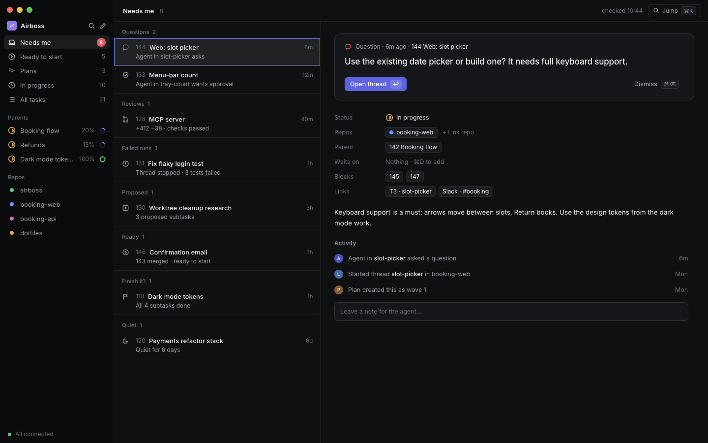

# Airboss

A to-do list where agents do the work. Drop in any task, from a one-line fix to a whole product, hand it to a coding agent with one key, and see where everything stands without opening a thread to ask.

On an aircraft carrier, the air boss launches every plane, tracks each one in the air and decides who lands next. Airboss does that for your agent threads.



*A design screenshot of Needs me, with made-up sample data. The built screen follows it closely.*

> **Alpha.** This is an early build for a few people to try. Expect rough edges, and please [say what you find](#feedback).

## Why

Running many agent threads at once has a cost. In seven weeks of one engineer's work, 35 of 853 threads were check-ins like "where are we?" or "find thread X". A stack of 10 PRs sat idle for 19 days before anyone noticed. Plan docs drifted out of date, and tasks were spread across memory, saved chat messages and a tracker.

To-do apps don't know agent threads exist. Agent tools know threads, but not tasks or plans. Airboss joins the task, its threads, its PRs and its plan, and gets status from the agents, from GitHub and from T3 Code, so you don't type it.

## What it does

- **Capture from anywhere.** ⌃⌥N opens a quick-add box over any app. Paste a PR, issue, Slack or `t3code://` link into it and it's attached.
- **Tasks of any size.** Every task can have subtasks, at any depth, linked to one or more repos. Subtasks can wait on each other, and a parent shows its run order in waves.
- **Do it and Plan it.** ⌘↩ starts an agent for the task, in a T3 Code thread or a Herdr tab, one per linked repo, each in its own worktree on a shared branch, with the task's notes as the brief. ⇧⌘↩ starts a planning thread, and the settled plan comes back as subtasks.
- **Needs me first.** The home screen lists what is waiting on you: agent questions and approvals, PRs to review, failed runs, agents that stopped without a PR, proposed subtasks, tasks that just became ready, parents whose subtasks are all done, and work quiet for 5 days. The menu-bar icon shows the count.
- **Status is read, not typed.** Agents report through an MCP server. A merged PR finishes its task. T3 Code and Herdr show whether an agent is working, waiting on you or stopped.
- **Agents propose, you decide.** Agents can move their tasks along and propose new ones. Only you accept proposals, drop tasks, or finish a task whose PR hasn't merged.
- **Keyboard first, and a real Mac app.** Native menus, a menu-bar item, open at login, dark and light, ⌘K to jump anywhere, ⌘Z to undo a slip, and a shortcut for every main action.
- **A CLI too.** The `airboss` command adds, moves, links and finishes tasks from a terminal, and accepts or rejects proposals.

## Install

You need a Mac with Apple silicon, on macOS 13 or later.

1. In Terminal:

   ```sh
   curl -fsSL https://raw.githubusercontent.com/amantibrewal310/airboss/main/install.sh | sh
   ```

   It downloads the newest release, checks it against its SHA-256, puts Airboss in Applications and opens it. Run it again to update. ([Read it first](install.sh) if you like: it's short.)

   The alpha isn't notarized by Apple yet. A copy downloaded in a browser gets "Apple could not verify Airboss…" the first time. If you went that way, clear the flag once with `xattr -dr com.apple.quarantine /Applications/Airboss.app`.
2. On the first-run screen:
   - Tick the repos you work in, from T3 Code's projects, Herdr's spaces, or any folder.
   - In **Agents**, choose **Install command-line tool**, then **Connect Claude Code**. That registers Airboss's MCP server with Claude Code, at user scope. Codex takes one more step: see [Getting started](docs/getting-started.md#codex).
   - Paste the agent note (**Help › Copy Agent Note**) into each repo's `AGENTS.md` or `CLAUDE.md`.

Airboss works on its own, and each of these turns on more. Without them, those features switch off and say why:

- T3 Code or Herdr: Do it, Plan it, and live thread state. With both, choose in **Settings › Agent setup › Start agents in**.
- Claude Code or Codex: agents report on their tasks.
- The GitHub CLI (`gh`), signed in: PR state, reviews and checks.

From 0.1.0-alpha.4 on, Airboss updates itself. When a new version is out, the foot of the sidebar says so, and **Update and restart** installs it. Your tasks and settings stay where they are. For alpha 3 and earlier, quit Airboss and run the same line again, once.

### Build from source

You need Rust (`rust-toolchain.toml` pins 1.100, and rustup installs it on the first build), Node 24 and pnpm.

```sh
git clone https://github.com/amantibrewal310/airboss.git
cd airboss/app
pnpm install
pnpm tauri build --config src-tauri/tauri.bundle.conf.json --bundles app
cp -R ../target/release/bundle/macos/Airboss.app /Applications/
open /Applications/Airboss.app
```

A build you made yourself isn't flagged as downloaded, so it opens straight away.

## Docs

- [Getting started](docs/getting-started.md): build, install, first run, connecting agents
- [Using Airboss](docs/using-airboss.md): the daily flow, and every keyboard shortcut
- [CLI](docs/cli.md): every `airboss` command
- [MCP tools](docs/mcp.md): what agents can call, and what they get back
- [Architecture](docs/architecture.md): processes, the database and the data model
- [Troubleshooting](docs/troubleshooting.md)
- [Contributing](CONTRIBUTING.md)

The design is in [DESIGN.md](DESIGN.md) and [docs/design](docs/design/README.md). Each module has a spec, listed in [CAPABILITIES.md](CAPABILITIES.md).

## Status

Alpha: 0.1.0-alpha.6 ([what changed](CHANGELOG.md)). Every module is built, tested and merged: the task store, the MCP server and CLI, the Mac app, Do it and Plan it, sync with GitHub and T3 Code, and Needs me. Every Rust crate is tested (`cargo test --workspace`), and the interface has unit, component and end-to-end tests. The native parts (menus, the hotkey, notifications, the menu bar) were also checked by hand on a real Mac.

Known gaps:

- It isn't notarized: install it with the line above, or clear the download flag. It's Apple silicon only.
- It's built around T3 Code or Herdr, Claude Code or Codex, and `gh`. Other agent tools can report through MCP, but Do it and Plan it start agents only in T3 Code or Herdr.
- Plan it doesn't yet show that a planning thread is running until its plan comes back.
- VoiceOver has been checked through the accessibility tree, not yet by listening.

## Feedback

- **Help › Report a Problem…** in the app opens a bug report here with your Airboss and macOS versions filled in.
- Or open an issue: [a bug](https://github.com/amantibrewal310/airboss/issues/new?template=bug.yml), or [alpha feedback](https://github.com/amantibrewal310/airboss/issues/new?template=feedback.yml) on what worked and what got in the way.
- The log is at `~/Library/Logs/Airboss/app.log`. It can name your tasks, repos and folders, so read it before you share it.
- Security problems: please report them privately, as [SECURITY.md](SECURITY.md) says.

## Privacy

Airboss is local only. There's no account, no server and no telemetry.

- Tasks live in one SQLite file on your Mac, `~/Library/Application Support/Airboss/airboss.db`.
- The app opens no network port, and its windows load nothing from the network.
- The `gh` CLI reads the PRs you've linked, and your own open PRs, from GitHub, about every 5 minutes, with your own `gh` sign-in.
- Every 6 hours Airboss reads one small file from GitHub, [`updates/latest.json`](updates/), to see whether there's a newer version. **Update and restart** downloads it from the GitHub release and checks its signature before installing. Neither sends anything about you or your tasks. Turn the check off in Settings.
- That's all the network traffic.
- It reads T3 Code's database read-only, and Claude Code's session files in `~/.claude/sessions`, to see what your agents are doing. It never writes to either.
- Do it and Plan it run the `t3` CLI, which starts threads in T3 Code on your Mac, or Herdr's `herdr-app` and `hc`, which open tabs in Herdr. For Herdr, Airboss makes the task's git worktree itself, and follows its agents through `hc events`.
- **Help › Report a Problem…** only opens a GitHub page in your browser. Nothing is sent unless you submit it there.

## License

MIT. See [LICENSE](LICENSE).
