# Airboss design

The rules are in [DESIGN.md](../../DESIGN.md). This folder holds the material behind them.

| What | Where |
|---|---|
| Working prototype: click it, use it from the keyboard, switch dark and light | [prototype.html](prototype.html), which opens on its own in a browser |
| Tokens and component styles (dark first) | [airboss.css](airboss.css) |
| Screens exported from the Paper file "Airboss" | [screens/](screens/) |

The Paper file has four pages: Foundations, App screens, Overlays and States. It uses the same tokens as `airboss.css`. All task names, numbers and repos in the designs are made-up sample data.

## Screens

| | |
|---|---|
| 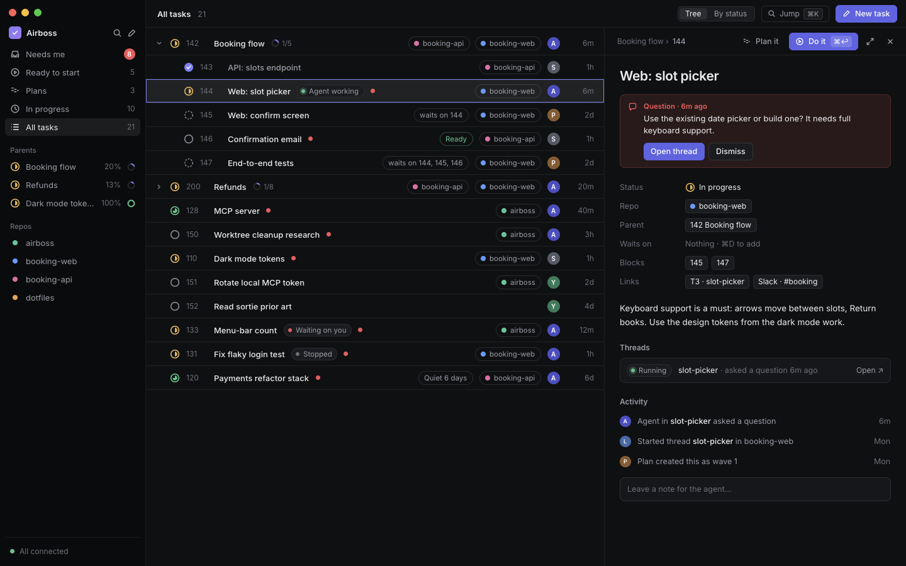 | 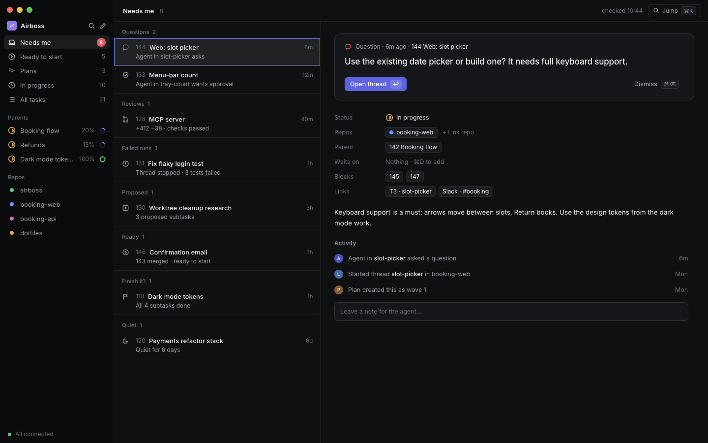 |
| All tasks, with the selected task in the detail panel | Needs me: decisions in a two-pane inbox |
| 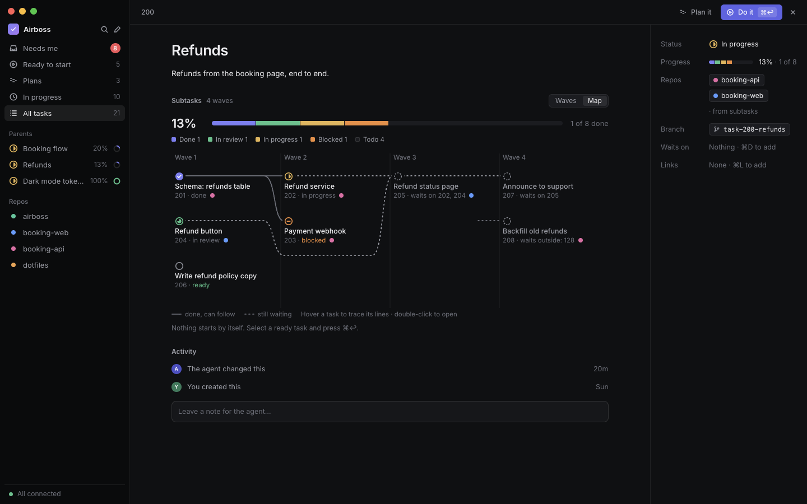 | 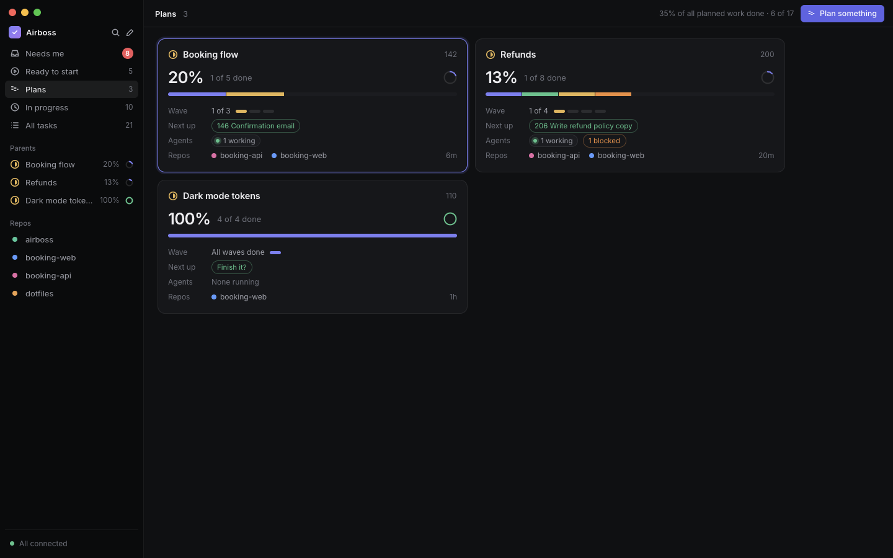 |
| Task page: progress and the run-order map | Plans: every parent task with its progress |
| 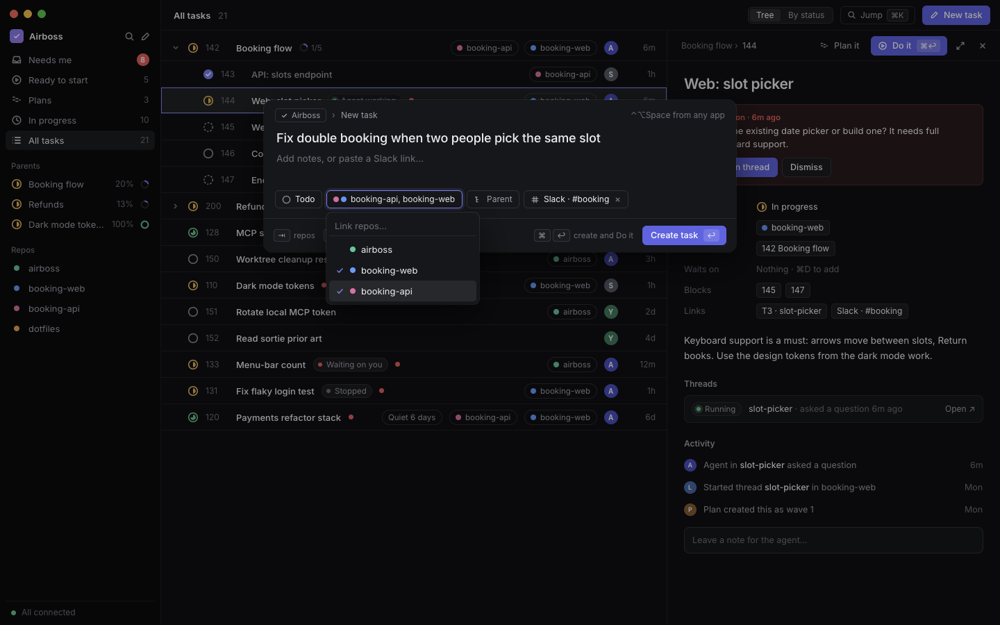 | 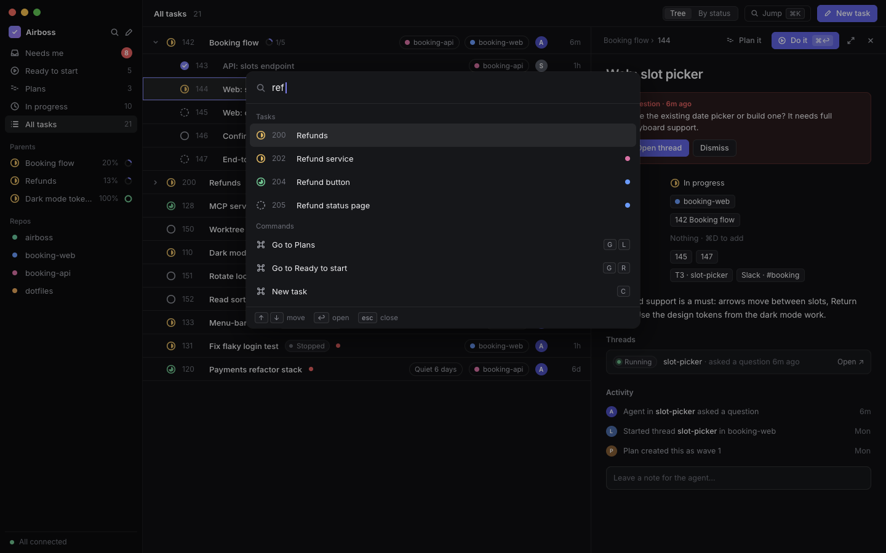 |
| New task (⌃⌥N from anywhere, C or ⌥N in the app) | Jump to a task or run a command (⌘K) |
| 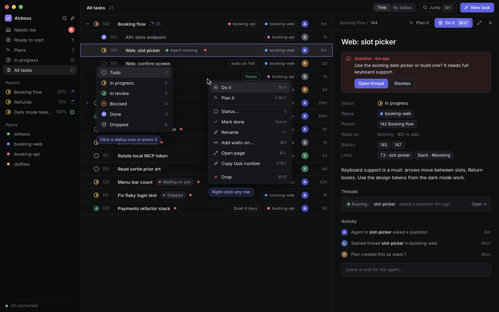 | 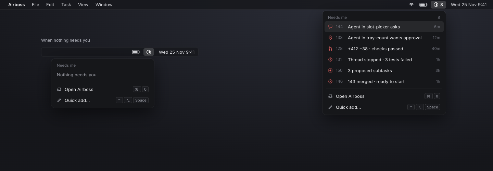 |
| Status picker (S) and right-click menu | Menu-bar icon and dropdown |
| 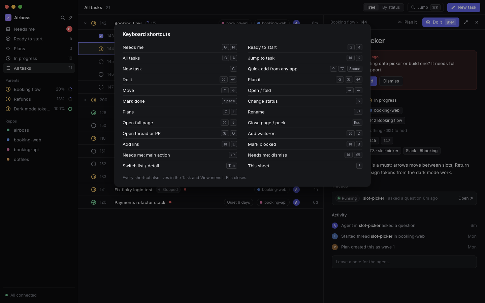 | 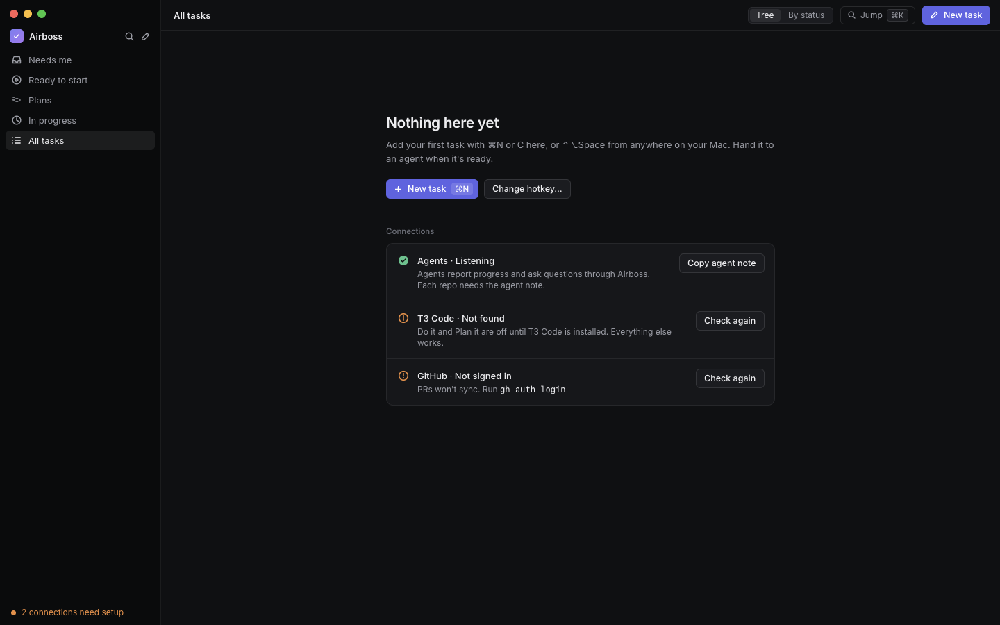 |
| Keyboard shortcuts (?) | First run, with setup checks |
| 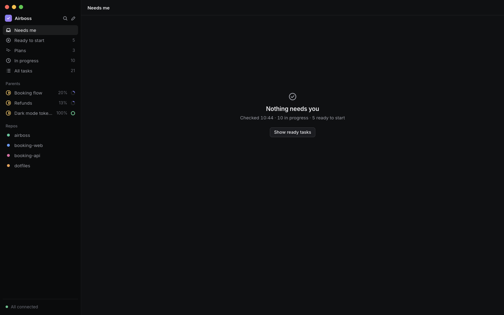 | 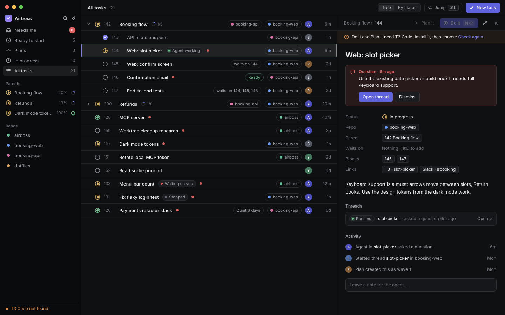 |
| Nothing needs you | T3 Code missing: Do it and Plan it switch off |
| 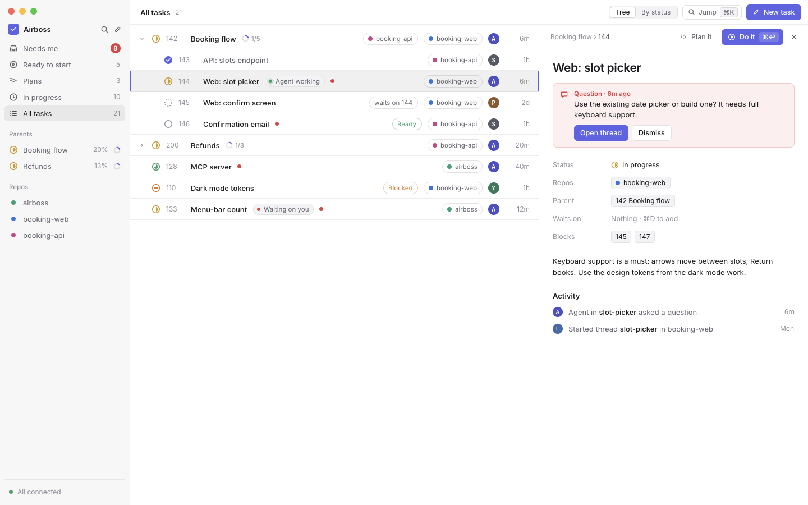 | |
| Light mode | |

## Foundations

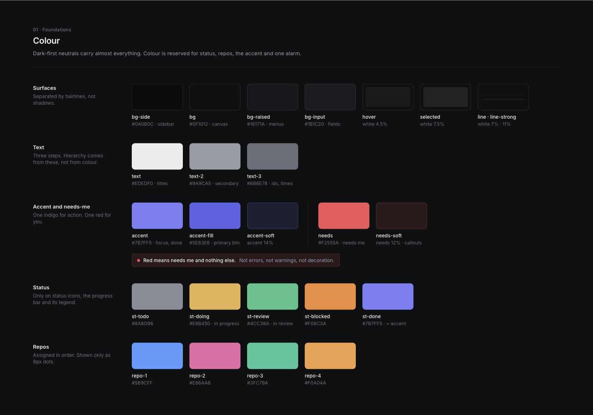
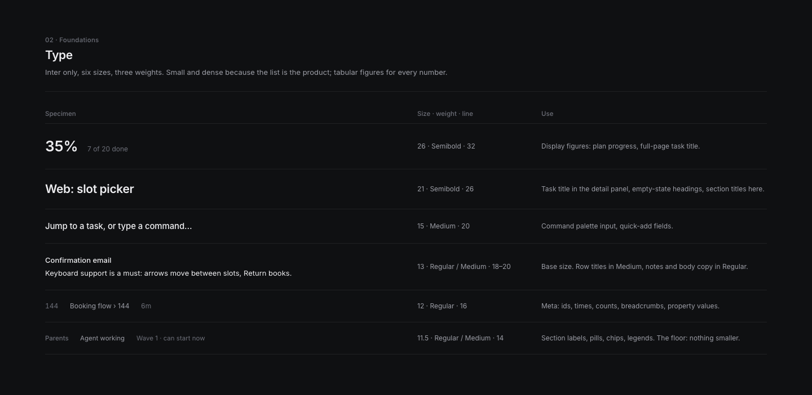
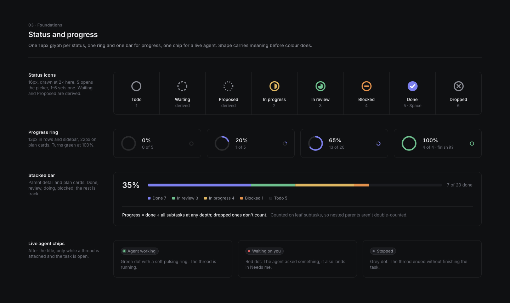
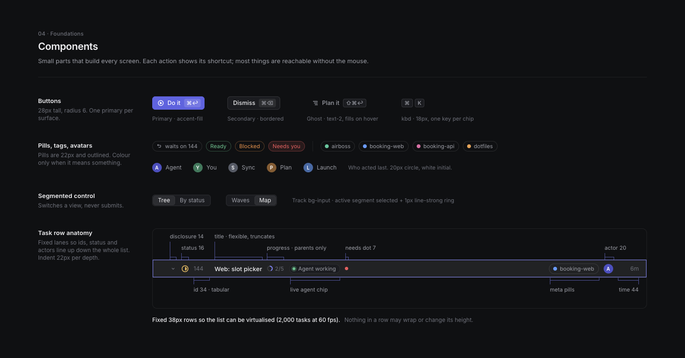
